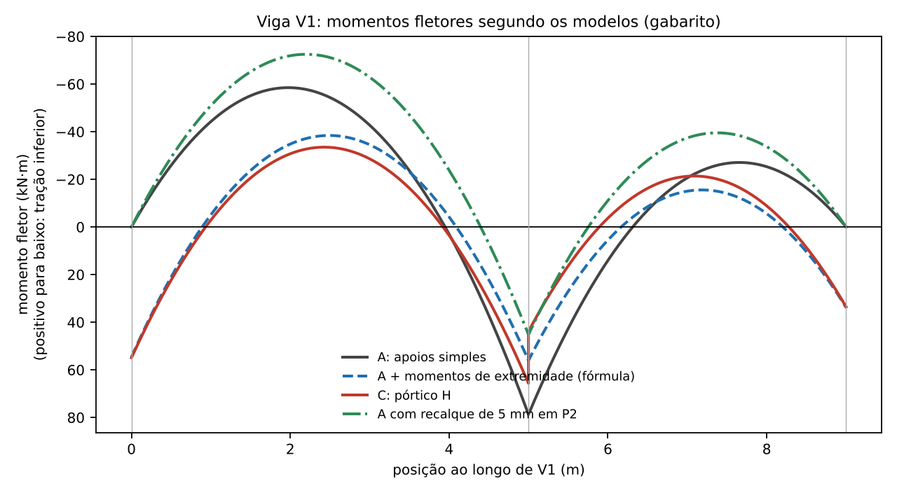

# Gabarito e roteiro do professor: aulas 03A e 03B

> Material de uso do professor. Este arquivo fica fora da pasta `source/` e não é publicado no site.

## Como estes resultados foram obtidos

Os resultados foram calculados com um solver de pórticos planos (método da rigidez, barras de Euler-Bernoulli com deformação axial, sem deformação por cortante), validado antes do uso contra soluções analíticas: viga biapoiada ($ql^2/8$), viga biengastada ($ql^2/12$ e $ql^2/24$), viga contínua de dois vãos iguais ($ql^2/8$ no apoio e reação central $5ql/4$) e pilar em balanço ($Hh$ e $Hh^3/3EI$). Os valores devem coincidir com os do Ftool dentro do arredondamento. Convenção: momentos com módulo; nas vigas, positivo = tração na face inferior. Concreto C30, $E_{ci}=3{,}067\times10^{7}\text{ kN/m}^2$. Ações de serviço, sem majoração.

## Observação sobre o slide 3 da aula 19

No slide 3 da apresentação da aula 19 (origem da Aula 03B), os denominadores das três expressões (M_viga, M_sup e M_inf) aparecem como $4\,r_{sup}+6\,r_{inf}+6\,r_{viga}$. Pela dedução (viga com a outra extremidade engastada, $K=4EI/l$, e pilar de comprimento $l/2$ com a extremidade oposta rotulada, $K=3EI/(l/2)=6EI/l$), o denominador correto é $4\,r_{viga}+6\,r_{sup}+6\,r_{inf}$; só assim $M_{viga}=M_{sup}+M_{inf}$ e as expressões coincidem com o pórtico H resolvido no Ftool (diferença abaixo de 1 %, tabela da Parte 3). A Aula 03B já traz a expressão corrigida. Convém corrigir o slide.

## Aula 03A

### Exercício 1: pilar em balanço

Dados: $20\times60$ cm, $I_c=3{,}6\times10^{-3}\text{ m}^4$, $E_{ci}I_c=110421\text{ kN·m}^2$, $(EI)_{sec}=0{,}8E_{ci}I_c=88337\text{ kN·m}^2$.

| Item | Resultado |
|---|---:|
| $M_1=F_Hl_e$ | 186,0 kN·m |
| $u_1=F_Hl_e^3/(3EI)$ | 6,07 cm |
| $M_2'=M_1+F_Vu_1$ (1ª atualização) | 222,4 kN·m (+19,6 %) |
| Iteração 1: $H^*=23,92$ kN, $u=7,26$ cm, $M=F_Hl_e+F_Vu=229,6$ kN·m | |
| Iteração 2: $H^*=24,68$ kN, $u=7,49$ cm, $M=F_Hl_e+F_Vu=231,0$ kN·m | |
| Iteração 3: $H^*=24,83$ kN, $u=7,54$ cm, $M=F_Hl_e+F_Vu=231,2$ kN·m | |
| Solução exata de viga-coluna (referência) | $u=7,94$ cm; $M_2=233,7$ kN·m (+25,6 %) |
| Carga crítica de Euler, $\pi^2EI/(4l_e^2)$ | 2520 kN ($F_V/P_{cr}=0,24$) |

A iteração com a força horizontal fictícia converge para valores ligeiramente abaixo da solução exata, porque a força fictícia reproduz o momento da base mas não a forma exata do diagrama de momentos ao longo do pilar. A diferença (cerca de 1 %) é um bom ponto para discutir a ordem de grandeza do erro de um processo iterativo simplificado. Não afirme que o Ftool tenha análise P-Δ: se a versão da turma tiver, compare com $M_2$ exato.

### Exercícios 2 e 3: pórtico plano do eixo 2

Cargas lineares: pavimentos-tipo $8{,}0\times4{,}0+1{,}75=33{,}75$ kN/m; cobertura $6{,}0\times4{,}0+1{,}75=25{,}75$ kN/m. Carga vertical total por pórtico: $(2\times33{,}75+25{,}75)\times9{,}0=839{,}25$ kN (confira a soma dos esforços normais na base).

| Resultado | Pórtico, $E_{ci}I_c$ (só V) | Pórtico, $E_{ci}I_c$ (V+H) | Pórtico, rigidez secante (V+H) | Viga isolada (só V) |
|---|---:|---:|---:|---:|
| Deslocamento horizontal do topo (mm) | 0,0 | 4,2 | 8,2 | – |
| Momento na base do pilar A (kN·m) | 13,6 | 20,9 | 26,2 | – |
| Momento na base do pilar B (kN·m) | 5,2 | 65,6 | 75,8 | – |
| Momento na base do pilar C (kN·m) | 8,5 | 42,8 | 49,5 | – |
| Viga 1º pav.: momento no apoio A (kN·m) | -61,6 | -35,8 | -44,9 | 0,0 |
| Viga 1º pav.: momento no apoio B, esq. (kN·m) | -72,1 | -97,2 | -91,7 | -88,6 |
| Viga 1º pav.: momento máximo no vão A-B (kN·m) | 38,7 | 41,2 | 38,5 | 65,8 |
| Viga 1º pav.: reação em B (kN) | 156,8 | 151,9 | 150,5 | 191,7 |

Observações: (i) os momentos de extremidade da viga no Ftool aparecem com sinal negativo (tração na face superior); (ii) esforços normais na base (compressão, kN), V+H com $E_{ci}I_c$: A = -205,3, B = -421,5, C = -212,4; só V: A = -227,7, B = -432,0, C = -179,6; (iii) apenas H, $E_{ci}I_c$: topo = 4,20 mm; rigidez secante: 8,02 mm; os momentos de V+H são a soma dos casos V e H (superposição, análise linear); (iv) a viga isolada tem o momento negativo no apoio A nulo e o positivo muito maior que o do pórtico; já no apoio B o momento negativo é maior que o do pórtico só com cargas verticais.

Para discutir: a rigidez secante dobra o deslocamento lateral (de 4,24 para 8,16 mm, com $0{,}8$ nos pilares e $0{,}4$ nas vigas) e altera menos os momentos (apoio B da viga: de 97,2 para 91,7 kN·m; base do pilar B: de 65,6 para 75,8 kN·m), porque os momentos dependem das **rigidezes relativas**, enquanto os deslocamentos dependem da rigidez absoluta. O pórtico só com cargas verticais tem deslocamento horizontal do topo praticamente nulo (0,04 mm), efeito da pequena assimetria entre os vãos.

## Aula 03B: viga V1

### Partes 1 e 2: viga contínua e correções

- $M_B=30(5^3+4^3)/[8(5+4)]=78{,}75$ kN·m; reações $R_1=59{,}25$, $R_2=170{,}44$ e $R_3=40{,}31$ kN (soma $270{,}00$ kN).
- Rigidezes relativas: $r_{vig,1}=2,917\times10^{-4}$, $r_{vig,2}=3,646\times10^{-4}$, $r_{P1}=r_{P3}=6,720\times10^{-4}$ (cada tramo), $r_{P2}=2,753\times10^{-3}$ m³. Momentos de engastamento: $ql_1^2/12=62{,}50$ e $ql_2^2/12=40{,}00$ kN·m.
- Momentos no apoio extremo: P1 = **54,60** kN·m (fórmula completa) e 51,36 kN·m (simplificada); P3 = **33,87** kN·m (completa) e 31,47 kN·m (simplificada).
- Com os momentos de extremidade aplicados ao modelo A: $M^+_1=38,42$, $M_{P2}=56,06$, $M^+_2=15,55$ kN·m (fórmula completa); reações $74,71$, $140,84$ e $54,45$ kN.
- Correção (a): vão extremo, $9ql^2/128=52{,}73$ kN·m; vão interno biengastado, $ql^2/24=20{,}00$ kN·m. Os positivos do item 5 ($38{,}42$ e $15{,}55$) ficam **abaixo** desses valores, e a correção (a) governa: adotar $52{,}73$ e $20{,}00$ kN·m. No modelo A sem momentos de extremidade, os positivos ($58{,}51$ e $27{,}08$) já excedem esses mínimos.
- Correção (b): $b_{int}=0{,}80$ m (lado de $80$ cm de P2 na direção da viga) é maior que $3{,}10/4=0{,}775$ m, logo o apoio P2 é largo e vale a regra de engastamento perfeito: o momento negativo em P2 não pode ser menor que $62{,}50$ kN·m (vão 1) e $40{,}00$ kN·m (vão 2). Os valores do modelo A ($78{,}75$) e do item 5 ($56{,}06$, abaixo de $62{,}50$) mostram que, com os momentos de extremidade, a regra (b) também passa a governar o lado esquerdo do apoio.

### Partes 3 a 5: quadro de resultados

| Modelo | $M$ em P1 | $M^+$ vão 1 | $M$ em P2 (esq.) | $M$ em P2 (dir.) | $M^+$ vão 2 | $M$ em P3 | $R_1$ | $R_2$ | $R_3$ |
|---|---:|---:|---:|---:|---:|---:|---:|---:|---:|
| A: apoios simples | 0,00 | 58,51 | -78,75 | -78,75 | 27,08 | 0,00 | 59,25 | 170,44 | 40,31 |
| A com momentos de extremidade (fórmula completa) | -54,60 | 38,42 | -56,06 | -56,06 | 15,55 | -33,87 | 74,71 | 140,84 | 54,45 |
| A com momentos de extremidade (fórmula simplificada) | -51,36 | 39,35 | -57,49 | -57,49 | 16,23 | -31,47 | 73,77 | 142,73 | 53,50 |
| C: pórtico H (meia altura, rotulado) | -54,97 | 33,51 | -65,67 | -43,87 | 21,39 | -33,57 | 72,86 | 139,71 | 57,43 |
| E: pórtico H (altura inteira, engastado) | -51,90 | 34,50 | -66,90 | -45,37 | 21,97 | -31,12 | 72,00 | 141,56 | 56,44 |
| C com pilares na orientação fraca | -34,75 | 41,77 | -70,96 | -58,25 | 24,29 | -16,76 | 67,76 | 152,61 | 49,63 |
| C com pilares $20\times30$ / $20\times50$ | -38,36 | 39,17 | -72,33 | -52,14 | 24,48 | -20,92 | 68,21 | 149,60 | 52,19 |
| C, cobertura (sem tramo superior) | -48,24 | 35,79 | -68,22 | -47,69 | 22,71 | -27,72 | 71,01 | 143,99 | 55,01 |
| C com rigidez secante | -58,48 | 32,42 | -64,21 | -42,08 | 20,73 | -36,51 | 73,85 | 137,54 | 58,61 |
| A com recalque de 5 mm em P2 | 0,00 | 72,51 | -45,20 | -45,20 | 39,53 | 0,00 | 65,96 | 155,34 | 48,70 |

Momentos em kN·m (os negativos aparecem com sinal negativo; os de extremidade e de apoio são os valores nas seções de ligação com os pilares) e reações em kN.

Pontos para a discussão:

- **Fórmula x pórtico H.** Em P1, a fórmula completa dá $54{,}60$ e o modelo C, $54{,}97$ kN·m (0,7 %); em P3, $33{,}87$ e $33{,}57$ (0,9 %). A fórmula simplificada da norma é menos rígida: $51{,}36$ e $31{,}47$.
- **Momento de P2 (modelo C).** À esquerda, $65{,}67$ e, à direita, $43{,}87$ kN·m: a diferença de $21{,}80$ kN·m é absorvida pelo pilar P2 (momento nos dois tramos, $M_{sup}+M_{inf}$).
- **Modelo A.** Superestima o momento positivo (58,5 contra 33,5 kN·m no vão 1) e o negativo em P2 (78,75 contra 65,7), e subestima as reações de P1 e P3 (a reação de P2 fica maior: 170,4 contra 139,7 kN).
- **Orientação do pilar.** Com os pilares na orientação fraca, os momentos de extremidade caem a cerca de 63 % em P1 e 50 % em P3 e o positivo sobe; o resultado se aproxima do modelo A.
- **Pilar da cobertura.** Sem o tramo superior, a rigidez total do nó cai e o momento de extremidade diminui (48,2 contra 55,0 kN·m em P1).
- **Rigidez secante.** Com $0{,}8$ nos pilares e $0{,}4$ na viga, a rigidez relativa dos pilares aumenta e os momentos de extremidade crescem (58,5 contra 55,0 kN·m em P1), enquanto os positivos diminuem.
- **Recalque de 5 mm em P2.** O momento negativo em P2 cai de $78{,}75$ para $45{,}20$ kN·m e os positivos sobem (vão 1: $72{,}51$; vão 2: $39{,}53$ kN·m). A rigidez axial de P2, $EA/l\approx1{,}6\times10^{6}$ kN/m, é cerca de 90 vezes a de flexão da viga ($48EI/l^3\approx1{,}7\times10^{4}$ kN/m para o vão de 5 m): o apoio só se comporta como indeslocável se a fundação também for rígida.

## Sugestão de condução

Aula 03A: 30 a 40 min de exposição (tipos de análise, console, rigidez secante, modelos e passo a passo do 3D ao 2D) e o restante em laboratório no Ftool: Exercício 1 (15 min), Exercício 2 (30 min) e Exercício 3 (20 min). Aula 03B: 30 min de exposição (correções da norma, nó extremo e rigidez dos pilares) e as Partes 1 a 5 em laboratório. Se o tempo for curto, sugerimos fazer as Partes 1 a 3 em sala e deixar as Partes 4 e 5 como atividade extraclasse.
